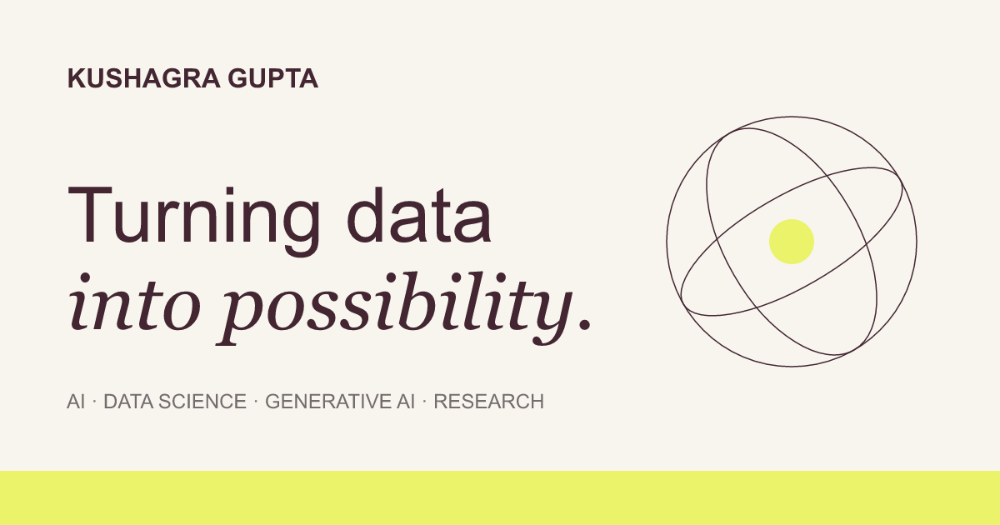

# Hi, I'm Kushagra

I'm an **AI Intern at IntellAxis AI** and a **PGP student in Artificial Intelligence & Data Science at Jio Institute, class of 2027**. I build AI products, study image forensics and develop tools that help people understand code, incidents and data.

I enjoy taking a problem from its first question to a working system, with results I can explain.

[Explore my portfolio](https://kushagragupta-23.github.io/) · [Connect on LinkedIn](https://www.linkedin.com/in/kushagragupta2310/) · [Email me](mailto:Kushagra.G27pgai@jioinstitute.edu.in)

## About me

- **IntellAxis AI:** AI Intern since October 2026; building OpenVid AI as a live project since August 2026.
- **Jio Institute:** PGP in AI & Data Science, April 2026–expected 2027.
- **HCLTech:** Graduate Engineer Trainee on the Citrix CVAD team, September 2024–June 2025. Investigated customer incidents in virtualization and cloud environments.
- **SRMIST, NCR Campus:** B.Tech in Computer Science & Engineering, September 2020–June 2024; CGPA 8.78.
- **NTU Singapore:** Student exchange, August–September 2026.
- **AI-Native Challenger:** First place at Jio Institute in April 2026. Led the technology work for our team's AI-driven loan recovery solution.

Earlier work as a sports blogger taught me to research carefully and explain things plainly. Outside technology, I enjoy cricket, films, chess and learning languages.

## Selected projects

| Project | What I built | Explore |
| --- | --- | --- |
| **HydraFusion-Net** | Co-built a PyTorch image detector combining entropy and bit-plane features. Reported **95.2% test accuracy** on the project's 2,000-image test split. | [Code](https://github.com/kushagragupta-23/Dual-Cue-AI-Generated-Image-Detection-via-Entropy-and-Bit-Plane-Feature-Fusion) |
| **OpenVid AI** | Prompt- and document-to-video creation with narration, visuals and captions, built from scratch for IntellAxis AI. | [Project notes](https://kushagragupta-23.github.io/#project/openvid) |
| **RepoSage** | Local codebase search using AST metadata, BM25 and semantic retrieval, with answers linked to files, functions and lines. | [Code](https://github.com/kushagragupta-23/RepoSage) |
| **Nano-GPT** | Co-built a character-level, decoder-only Transformer in PyTorch and trained it on Shakespeare. | [Project notes](https://kushagragupta-23.github.io/#project/nano-gpt) |
| **OrbitalEye · 2026** | A group Databricks project with Bronze, Silver and Gold pipelines over approximately 38,000 synthetic satellite mission events. | [Project notes](https://kushagragupta-23.github.io/#project/orbitaleye) |
| **EduVerse** | Co-built a FastAPI e-learning platform with a team of five: courses, enrollments, assignments, progress tracking and AI tool interfaces. | [Code](https://github.com/kushagragupta-23/EdTechApp_pythonproject) |

I also built [OpsGuardian](https://github.com/kushagragupta-23/OpsGuardian) for incident investigation and [DataFlow Doctor](https://github.com/kushagragupta-23/DataFlow-Doctor) for pipeline debugging. Both use local retrieval to connect a diagnosis to its supporting evidence.

## Tools I work with

| Area | Tools and methods |
| --- | --- |
| **Machine learning** | Python, PyTorch, scikit-learn, computer vision, Transformers, model evaluation |
| **Generative AI** | LangChain, LangGraph, RAG, ChromaDB, Ollama, BM25 and hybrid retrieval |
| **Data** | SQL, Databricks, Pandas, PostgreSQL, Tableau, ETL pipelines |
| **Engineering** | FastAPI, SQLAlchemy, Streamlit, JavaScript, Docker, Git |

## Let's connect

I'm interested in applied AI, machine learning and data science work, and in Data Scientist or AI/ML Engineer roles after graduating in 2027.

[Portfolio](https://kushagragupta-23.github.io/) · [LinkedIn](https://www.linkedin.com/in/kushagragupta2310/) · [GitHub](https://github.com/kushagragupta-23) · [Kushagra.G27pgai@jioinstitute.edu.in](mailto:Kushagra.G27pgai@jioinstitute.edu.in)
